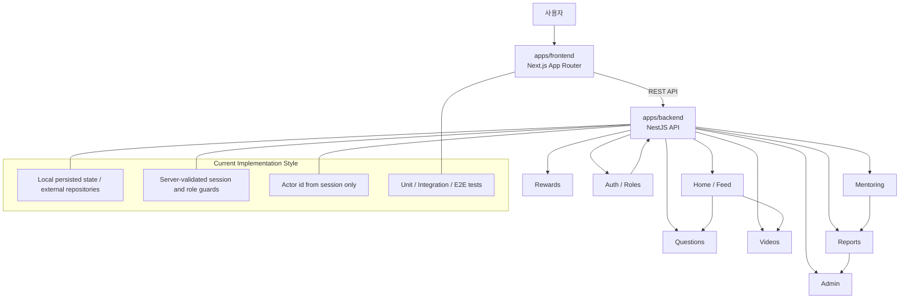

# KeepIt

KeepIt은 고등학생 대상 질문-답변 학습 커뮤니티입니다. 사용자는 질문을 올리고, 텍스트 또는 영상으로 답변을 받으며, 멘토링과 운영 기능으로 학습 경험을 확장할 수 있습니다.

## 프로젝트 구성

KeepIt 워크스페이스는 2개 앱으로 구성됩니다.

- `apps/backend`: NestJS 기반 API 서버
- `apps/frontend`: Next.js 15 App Router 기반 웹 클라이언트

## 핵심 기능

- 홈 피드에서 영상과 질문을 함께 노출
- 질문/답변/신고 흐름 제공
- 관리자 대시보드에서 신고 큐와 SLA 상태 확인
- 역할 기반 UI로 학생/멘토/관리자 화면 분리

## 아키텍처



## 개발 환경 요구사항

- Node.js 20+
- npm 10+
- Git
- FFmpeg 및 ffprobe: 영상 미리보기 생성에 필요하며 `PATH` 또는 `FFMPEG_PATH` / `FFPROBE_PATH`로 지정
- macOS / Windows / Linux

## 로컬 데이터와 접근 권한

- 외부 테이블 연결이 없으면 계정·세션·질문·답변·영상 정보·댓글·친구·쪽지·멘토링·신고·포인트를 로컬 스냅샷으로 저장합니다. 재시작 시 같은 저장 경로를 사용해야 합니다.
- 저장 경로 우선순위는 `LOCAL_STATE_DIR`, `DB_PATH`의 절대 경로 뒤에 `.state`를 붙인 디렉터리, 백엔드 실행 경로의 `data/state`입니다. 업로드 파일 경로는 별도 `UPLOADS_DIR`입니다.
- `LOCAL_PERSISTENCE=off`이면 스냅샷 저장을 끕니다. `AUTH_STORAGE_PROVIDER=memory`는 인증 저장소만 휘발성으로 실행합니다. 테스트는 `LOCAL_STATE_DIR`를 명시한 경우를 제외하고 영속 저장하지 않습니다.
- 로컬 저장은 단일 백엔드 프로세스용입니다. 동일 디렉터리를 여러 프로세스가 동시에 공유하지 마세요. 세션과 개인정보가 포함되므로 저장·업로드 디렉터리를 함께 안전하게 백업해야 합니다.
- 사용자 식별과 권한은 `keepit-session`으로 검증합니다. 클라이언트의 `x-user-id` / `x-user-role`은 인증 근거가 아닙니다. 신고 전체 목록·심사·포인트 지급은 관리자만 허용하며 포인트 내역은 본인과 관리자만 조회합니다.
- `GOOGLE_ADMIN_EMAILS`는 검증된 Google 로그인용 관리자 목록입니다. 공개 로컬 가입에서는 해당 이메일을 예약 처리하고, 비밀번호 로그인은 이메일 목록만으로 승격하지 않습니다. 로컬 관리자 역할은 내부 개발 시드 또는 기존 관리자가 부여해야 합니다. `DEV_SEED_ADMIN=true`는 개발 환경에서만 사용하세요.
- 현재 멘토링 대화는 작성자와 관리자만 조회·응답할 수 있습니다. 별도 멘토 배정 모델은 아직 없습니다.
- 서버 업로드 영상의 원본은 로그인한 회원만 접근합니다. 비회원은 실제 길이의 절반으로 인코딩한 `/uploads/:name/preview`만 재생합니다. FFmpeg 실패 시 503을 반환하며 원본을 대신 공개하지 않습니다. 외부 영상 URL 자체의 접근 제어는 보장하지 않습니다.
- 로컬 계정 비밀번호는 해시로 저장합니다. 외부 테이블 인증 저장소의 기존 비밀번호 보관 방식은 별도 보완이 필요하며 이번 로컬 검증의 보장 범위가 아닙니다.

## 빠른 시작

1. 저장소를 클론하고 워크스페이스를 엽니다.
2. 백엔드와 프론트엔드 의존성을 설치합니다.
3. 환경변수를 설정합니다.
4. 백엔드 → 프론트엔드 순서로 실행합니다.

### 1) 의존성 설치

```bash
cd apps/backend && npm install
cd ../frontend && npm install
```

### 2) 환경변수 설정

백엔드:

```bash
cd apps/backend
cp .env.example .env
```

주요 값:

- `GOOGLE_CLIENT_ID`
- `GOOGLE_CLIENT_SECRET`
- `GOOGLE_CALLBACK_URL`
- `FRONTEND_BASE_URL`
- `GOOGLE_ADMIN_EMAILS` (쉼표 구분 이메일 목록)

프론트엔드:

```bash
cd apps/frontend
cp .env.example .env.local
```

주요 값:

- `NEXT_PUBLIC_API_BASE_URL`

### GitHub 업로드 제외 기준

- 실제 환경변수 파일(`.env`, `.env.*`), 개인 키와 인증서 키 파일은 커밋하지 않습니다.
- `.env.example`, `.env.*.example`에는 실제 비밀값이나 개인정보 없이 설정 예시만 기록합니다.
- 로컬 데이터(`apps/backend/data/`, SQLite/DB 파일), 로그, `tmp/`, `.azure/`는 업로드하지 않습니다.
- 의존성과 빌드 결과(`node_modules/`, `.next/`, `dist/`, `coverage/`, `*.tsbuildinfo`)는 제외하고, 소스·테스트·의존성 잠금 파일은 커밋합니다.
- 푸시 전 `git status --short --ignored`와 `git diff --cached`로 대상을 확인합니다. 이미 추적 중인 파일은 `.gitignore`만으로 제외되지 않습니다.
- 비밀값이 이미 원격에 올라갔다면 파일 삭제만으로 해결되지 않으므로 해당 자격 증명을 폐기·재발급하고 기록 정리를 별도로 진행합니다.

### 3) 로컬 실행

백엔드:

```bash
cd apps/backend
npm run start:dev
```

프론트엔드:

```bash
cd apps/frontend
npm run dev
```

## 루트 스크립트

루트 `scripts/`로 백엔드/프론트를 한 번에 다룰 수 있습니다.

- `scripts/run-all.sh`: 백엔드 + 프론트 동시 실행
- `scripts/test-all.sh`: 백엔드 + 프론트 테스트 실행
- `scripts/tdd-cycle.sh`: TDD 사이클(단위/통합/E2E) 실행

## 테스트

커뮤니티 목록의 검색 응답 순서 역전, 통신 실패 안내·재시도, 등록 성공 후 목록 갱신 실패는 프론트엔드 통합 테스트로 검증합니다. 목록 갱신만 실패한 경우 등록 폼을 다시 제출하지 말고 목록의 `다시 시도`를 사용합니다.

### File Uploads

- Questions, answers, comments, and videos upload files using authenticated `POST /uploads` multipart requests. Records store file URLs, not Base64 payloads.
- Supported formats: JPEG, PNG, WebP, GIF, MP4, MOV, WebM, PDF. Images/documents: 10 MiB per file; videos: 30 MiB; attachments: up to four files. HEIC must be exported as JPEG first.
- File signatures and declared types are checked on the server. Upload progress, timeout messages, and retrying a failed form without re-uploading completed files are supported.
- Development stores files under `UPLOADS_DIR` (default: `apps/backend/data/uploads` when started from the backend directory). Keep this directory to preserve uploads across restarts.
- Production requires Blob storage. Prefer `AZURE_STORAGE_ACCOUNT_URL` with managed identity and the `Storage Blob Data Contributor` role. `AZURE_BLOB_CONNECTION_STRING` or the existing `AZURE_TABLES_CONNECTION_STRING` can be used as a compatibility fallback. Do not commit credentials.
- `AZURE_UPLOADS_CONTAINER` defaults to `keepit-uploads`. Blobs remain private; the API serves media through `GET /uploads/:name` with HTTP Range support for video seeking. File URLs are public capability URLs for shared posts; do not upload private chat documents here.
- Production without Blob configuration returns an error instead of using ephemeral local disk. Ensure the API ingress accepts multipart requests of at least 31 MiB and allows sufficient upload time.
- Signup profile photos are resized to JPEG previews of at most 256 pixels and 24,000 URL characters. Existing Base64 attachments remain readable; previously failed or corrupt media must be uploaded again.

### 백엔드

```bash
cd apps/backend
npm run test:unit
npm run test:integration
npm run test:e2e
npm run test:all
```

### 프론트엔드

```bash
cd apps/frontend
npm run test:unit
npm run test:integration
npm run test:e2e
npm run test:all
```

### 프론트엔드 빌드 검증

```bash
cd apps/frontend
npm run build
```

## TDD 개발 모드

워크스페이스에는 TDD 서브에이전트와 CI 자산이 포함되어 있습니다.

- 에이전트 정의: `.github/agents/`
  - `tdd-red.agent.md`
  - `tdd-green.agent.md`
  - `tdd-refactor.agent.md`
  - `tdd-orchestrator.agent.md`
- CI 테스트 매트릭스: `.github/workflows/tdd-test-matrix.yml`

로컬 TDD 사이클 실행:

```bash
bash scripts/tdd-cycle.sh backend
bash scripts/tdd-cycle.sh frontend
bash scripts/tdd-cycle.sh all
```

## Azure 배포

Azure 배포 가이드는 현재 정리 중입니다.

## 참고 문서

- [ARCHITECTURE.md](ARCHITECTURE.md)
- [PRD.md](PRD.md)
- [IDIA.md](IDIA.md)

## 디렉터리

- `apps/backend`: 서버 API 및 테스트
- `apps/frontend`: 웹 UI 및 프론트 테스트
- `작1`: 초기 산출물 보관 폴더
